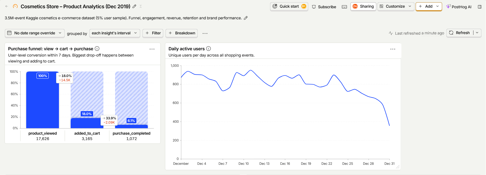
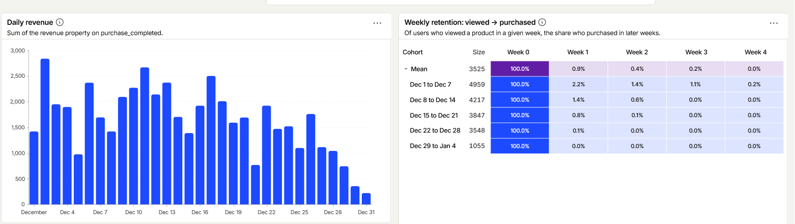
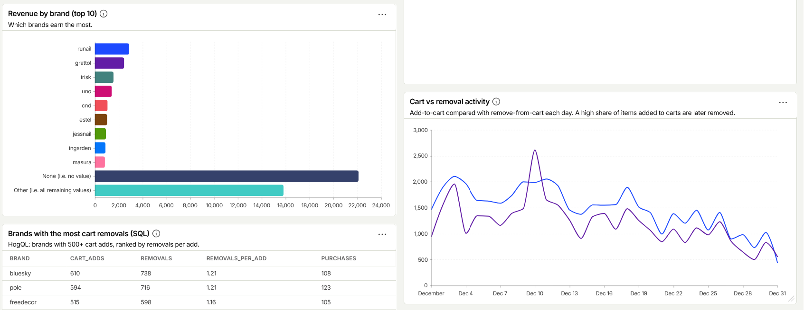

# Cosmetics Store: Product Analytics

An end-to-end product analytics project on **3.5 million real e-commerce events** from an online cosmetics store (December 2019).
The raw events are loaded into **DuckDB**, analyzed with **SQL**, and shown in an interactive dashboard.

**Dataset:** [eCommerce Events History in Cosmetics Shop](https://www.kaggle.com/datasets/mkechinov/ecommerce-events-history-in-cosmetics-shop) (Kaggle, mkechinov). Each row is one event (`view`, `cart`, `remove_from_cart` or `purchase`) with a product, brand, price, user ID and session ID.

## Questions answered
| Area | Question | Method |
|---|---|---|
| Funnel | Where do shoppers drop off? | User-level and session-level funnels from view to cart to purchase |
| Engagement | How do daily active users and revenue change over the month? When do people buy? | Daily and hourly totals |
| Retention | Do users come back? | Weekly cohort retention table |
| Product | Which brands and products earn the most? Which get removed from carts? | Revenue rankings and removals per cart add |
| Pricing | Does price affect conversion? | View-to-purchase rate by price band |
| Customers | How much more are repeat buyers worth? | Segments by number of orders |

## Key findings (Dec 2019)
- **7.0%** of users who viewed a product bought something. The biggest loss is between viewing and adding to cart: only 23% of viewers add anything.
- Conversion falls steeply with price, from **17.7%** for items under $5 to **1.4%** for items over $50.
- **9.7%** of buyers ordered more than once, and they brought in **21.5%** of revenue.
- Only about **15%** of a weekly cohort returns the following week.
- Sessions that end in a purchase have about 7× more events than browse-only sessions, and last a median of 13 minutes.

## Run it
1. Download `2019-Dec.csv` (or any month) from the dataset above into `data/`.
2. Run the analysis:
   ```
   pip install duckdb
   python analysis.py data/2019-Dec.csv
   ```
   This takes about 5 seconds and writes `results.json`.
3. Start a local server:
   ```
   python -m http.server 8000
   ```
   Then open http://localhost:8000.

## Files
- `analysis.py`: loads the CSV into DuckDB and runs all the SQL metrics, writing the results to `results.json`.
- `index.html`: the dashboard (Chart.js). It reads `results.json`, and the key findings are calculated from the data.
- `config.js` and `analytics.js`: optional PostHog tracking of people who visit the dashboard.

## Stack
Python · DuckDB (SQL) · Chart.js · PostHog


## PostHog analysis
A random 5% of users (about 177K events) were loaded into PostHog with their original timestamps and analyzed there too:

- **Dashboard:** *Cosmetics Store – Product Analytics (Dec 2019)*. [open the public dashboard](https://us.posthog.com/shared/jE426MDSl6Rrr5NkNc53tZ_vG1ODbw)
- **Charts:** a 7-day purchase funnel, daily active users, daily revenue (sum of the `revenue` property), weekly retention (users returning to view products), revenue by brand, cart adds vs removals, and a SQL table of the brands with the most cart removals.
- **SQL (HogQL) queries:** in [`posthog_queries/`](posthog_queries/)
  - `funnel_check.sql`: cross-checks PostHog's numbers against DuckDB
  - `repeat_buyers.sql`: compares revenue from one-time and repeat buyers
  - `cart_abandonment_by_brand.sql`: brands with the most cart removals

### Cross-check: PostHog vs DuckDB
| Metric | DuckDB (all users) | PostHog (5% sample) |
|---|---|---|
| View → purchase conversion | 7.0% | 7.0% |
| One-time buyers' average spend | $36.56 | $36.69 |
| Share of buyers who are repeat buyers | 9.7% | 8.9% |

The sample closely matches the full dataset, which shows the PostHog import and event names are correct.

### Screenshots



